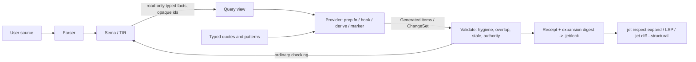

# Direct AST manipulation and a typed AST in Jet

Research report for the owner. Read-only investigation, 2026-10-07. Nothing in
the repository or Tower was changed. Probes ran in
`~/.cache/jet-dev/scratch/AstResearch1/probe/` against the shared candidate
`/mnt/jetscratch/candidates/dev-595e0dca3/jet`.

Evidence labels: **[OBSERVED]** means I ran it. **[SOURCE]** means a cited
file, decision record or external document says it. **[INFERENCE]** means my
reasoning, not a checked fact.

---

## 0. Summary

1. **The premise has moved.** The line "no AST mutation enters compilation"
   (D-FRONTENDAPI1=A, `Docs/spec/syntax-decisions.md:5216-5219`) and its
   siblings D-METAMUTATE1=A, S26's "rejected forever" list and D-META-GATE1's
   refusal list are no longer the whole current law. On 2026-09-21 the owner
   asked for "full Jai-level capabilities with powers above level 5 gated by
   metaprogramming opt-in" (decision record D-META-OPTIN2, detail section). Two
   decisions ratified that day: **D-META-CONTROL2=A** (checked change sets,
   code values, hygienic caller capture, call-site expansion providers, type
   construction, specialization, compiler workspaces and events) and
   **D-META-OPTIN2=A** (`metaprogramming: unrestricted` in the approved root
   package). On 2026-10-02, **D-GENERIC-TYPEFN1=A** made types the results of
   build-time functions in standard mode. The spec text still states the older
   rules side by side with the newer ones. That conflict needs an owner
   reconciliation (§7, B1).
2. **What still holds, and should keep holding:** no mutable handle into the
   compiler's internal trees, no forged inferred facts, every change rechecked
   by ordinary sema, and generated code that keeps its provenance. Every
   ratified layer, old and new, agrees on these points. They are the right
   invariants (§1.4, §4).
3. **Delivery lags the law.** Standard-mode derive and marker templates work
   **[OBSERVED]**. On this candidate, the read-only `core.compiler` value API
   fails in the repository's own example **[OBSERVED]**. The advanced API is
   only names in `Syntax.rs` and an open contract card (#3520 is `ready` with
   registry criteria open; its child cards were closed by consolidation, not
   by delivery) **[SOURCE]**.
4. **Recommendation.** Do not expose Jet's internal AST or TIR as an API. They
   are large and changing fast: 50 `Expr` variants, 119 `TExprKind` variants,
   and 381 commits to AST files since 2026-07-07 **[OBSERVED]**. Expose a
   **typed code model** instead, built from three parts:
   (a) typed quotes, meaning Jet surface syntax with typed holes, checked at
   the definition site;
   (b) surface-syntax patterns with typed captures, matched against resolved
   identities. This extends the codemod schema-2 matcher Jet already has;
   (c) an immutable, versioned, query-based view of checked facts, with opaque
   identities and no committed node shapes.
   Every transform, standard or advanced, then flows through one change-set
   and receipt format. That format is cached per item under the cone law,
   always visible through `jet inspect expand`, and recorded in the lock.
5. **New ideas worth balloting (§6):** rewrites that declare a contract level
   (equivalent, refines or changes) and carry evidence; expansion digests in
   the lock, reviewed like dependency updates; one change-set format for
   compiler providers, `jet fix`, codemods, `jet try`, LSP and AI agents;
   Halide-style schedules for SoA and parallel transforms; and Jai's message
   loop recast as a deterministic, cached dataflow of typed stage hooks.

---

## 1. What Jet has today

### 1.1 The decision trail

| Date | Decision(s) | Effect | Where |
|---|---|---|---|
| pre-Aug | **S26** | Comptime is value-only and "never creates, parameterizes, or selects a type". "Rejected forever: token/AST/attribute macros, custom syntax, comptime types, const generics in v1." | `syntax-decisions.md:2913-2920` |
| pre-Aug | **D-EXT1** | Tier 0/1 (methods, traits, operators) open to all; Tier 2 DSL blocks stdlib-only; Tier 3 proc macros and Tier 4 grammar changes rejected "even for experts". | `syntax-decisions.md:2022-2024` |
| pre-Aug | **D-FRONTENDAPI1=A, D-DSLBLOCK1=A, D-METAMUTATE1=A** | `core.compiler` exposes stable read-only lexer, parser, check, semindex and source-map values plus a CLI JSON mirror. Internal crates stay private and "no AST mutation enters compilation". DSL blocks are a fixed stdlib whitelist. "Jai-style AST mutation/message loop/user macros are rejected." | `syntax-decisions.md:5216-5225` |
| 2026-08-06 | **D-META-ONE1, D-META-CODE1, D-META-USER1, D-META-DSL1, D-META-EFFECT1** (card c0jq7pog) | Compiler rules become Jet declarations. Generated code is "real code with holes", never strings. User rules may record facts and **add** code. Libraries may declare text-block languages (amends D-DSLBLOCK1; the grammar stays closed). One effect model for both stages. Option B of D-META-CODE1, a first-class nestable `code { … }` value "used by Scala 3 and Template Haskell", was **declined** because "nothing needs a first-class value yet". | Tower decision records |
| 2026-08-08 | **D-CTCODEGEN1, D-METADEPTH1** | Derive output re-enters the lexer, parser and sema like hand-written code; "a pre-parsed AST is never injected". Ceiling: whole-program read-only reflection plus derives; no mutation, no AST injection, no grammar macros. | `syntax-decisions.md:2998-3003` |
| 2026-08-19 | **D-STRUCT-ONCE1, D-DEVR-CONE1** | `@loop` (now `prep loop`) reaches marker bodies, impls and tests; generated declarations are checked "as if written". **Cone law:** re-check latency must scale with the edit's blast radius, not program size. | `syntax-decisions.md:3041-3050`; Tower |
| 2026-09-19 | **D-META-GATE1, D-BUILD-GENVALUE1, D-CONSTGEN1** | `Meta.Generate` and `Meta.Include` become deniable effect capabilities. Explicitly **refused**: "splice into existing code, token or tree macros, use-site type factories, in-place rewrite, a type with no file, running the program inside the compiler"; "Rewrite and Tokens are never named." `generate { … }` gets type `Generated`. Const generics land. | Tower |
| 2026-09-21 | **D-META-REFLECT2, D-META-PUBLISH2, D-META-CONTROL2, D-META-OPTIN2** (card #3520) | Complete typed reflection roots. `compiler.generate(name, Generated)` publishes additively. Advanced sessions: `code.parse_expression/statements/items`, `code.of`, `code.caller`, hygienic insertion, serialization, type constructors, `bake` and `specialize`, a ChangeSet with `add/remove/replace_body/replace_signature/replace_type/insert`, atomic recheck of affected callers, receipts, workspaces, and deterministic compile events. Opt-in is `metaprogramming: unrestricted` in the root package plus explicit target registration. | `syntax-decisions.md:3063-3105`; Tower detail |
| 2026-09-30 / 10-01 | **D-META-ROOT3, D-NAME-SPLICE1=B, D-MARKER-LAW1** | Facts are read as `$` members (`T.$fields`). `$` also splices names in templates. Package markers may add items and reject programs; only Jet's own markers change checking. | Tower |
| 2026-10-02 | **D-GENERIC-TYPEFN1=A** | Zig-style generics: `prep fn Pair(T: Type) -> Type { struct { … } }`; `<>` removed. Types are made by build-time functions in standard mode. Ratified but not built (`Docs/proposals/owner-feedback-2026-10-05.md:167,303`). | Tower |
| 2026-10-06 | **D-HOOK-ONE1=A**; **D-HOOK-STAGES1 open** | One typed hook mechanism (`#On(point)`). The compiler-stage hook ballot is open. Its option A runs every hook in the zero-import WASM sandbox, returns findings, `Generated` items or change sets, and caches per item. | Tower |
| open | **D-COMPTIME-WORD1, D-META-HASH1, D-SURFACE-BUDGET1** | `prep` vs `comptime`; whether `##` becomes the metaprogramming operator; a counted surface budget. All three affect how any quote syntax would be spelled. | Tower |

### 1.2 What exists in code **[OBSERVED]**

- **Derive and marker templates work.** `Examples/features/reflection/derive_loop.jet`
  runs on the candidate and prints `x y x y generated`. `prep loop field in T.$fields`
  with `fn $method(self)` produces checked methods.
- **`jet inspect expand` lists provenance but does not print the expanded
  source.** `--facts templates` prints entries such as
  `derive_loop.jet:14:9 impl Point [marked_x] [from closed comptime prep loop]`,
  but not the generated items' text. `--facts derive` lists derived traits per
  type.
- **`core.compiler` is a thin, stringly typed, item-level view.**
  `Core/compiler/compiler.jet:30-60` declares `lex`, `parse`, `check`,
  `source_map`, `manifest`, `package`, `lock` and `profiles` as compile-time
  intrinsics. Their bodies `panic` unless the compiler supplies them. A
  `CompilerNode` has only `kind: String`, `name: String?` and `span`
  (`Compiler/JetFoundation/Source/Registry/CoreRecordRows.jet:206-208`). The
  services schema is version 1 (`Compiler/JetEval/Source/CompilerServices.jet:143`).
  So the public "AST" today is a list of top-level item kinds, not a tree.
- **The read-only API fails on this candidate.** A copy of
  `Examples/features/tooling/compiler_api` run with `jet build` on
  dev-595e0dca3 reports `E0953 … core.compiler.lex requires compiler-owned
  compile-time evaluation` and `E0956 __fragment: call argument local has no
  resolved type`. My own probe gave the same result
  (`probe/capi/run.jet`). The golden `Examples/features/expected/tooling/compiler_api.out`
  expects `compiler API`. **This looks like a regression and should be filed
  as a defect** (AGENTS.md: a code/requirement conflict is a defect).
- **Codemods already do pattern-based typed rewriting, outside compilation.**
  `spec.md:3546-3606` describes `jet inspect codemod` schema 2. It runs
  `symbol_rename` and `ast_rewrite` rules over `expr`, `stmt`, `item` and
  `type` nodes, with `$value` and `$values...` captures, "compiler-owned AST
  boundaries and resolved definition anchors, not token spelling". Each rule
  declares an exact match count. Edits are transactional, journaled and
  undoable, and rule N+1 sees a reindexed overlay. Roots are limited to
  `Examples/` and `tests/ui/`.
- **Other edit and inspection tools.** `jet fix` applies machine-applicable
  diagnostic fixes. `jet try <plan.json>` speculatively applies a plan and
  re-checks its claims. `jet diff --structural` compares checked definitions
  by semantic identity. `jet generate <GeneratorJob>` runs an explicit
  generator with a receipt. `jet inspect semindex --json` emits schema v20
  (`spec.md:3531`).
- **A compiler-extension sandbox exists.** D-DX5-HOOK1=A
  (`Docs/spec/architecture.md:822-866`) sends a versioned, typed, read-only
  post-sema snapshot (types, symbols, spans, effects, provenance) to a
  zero-import WASM component. The guest returns findings and
  `{span_id, replacement, rationale}` edit proposals that the host validates
  and stages. Registration is the `JET_COMPILER_EXTENSION` environment
  variable.
- **The internal trees are Jet data types.** The compiler is being self-hosted.
  `Compiler/JetFoundation/Source/AST/` (Expressions, Statements, Items,
  Patterns, Comptime; 2,368 lines) defines `pub enum Expr` with 50 variants.
  `TIR/TIR.jet` (2,708 lines) defines `TExprKind` with 119 variants and
  `TStmt` with 50. Since 2026-07-07, 381 commits touched AST files and 372
  touched TIR files, out of 6,374 total. The semindex schema went from v12 to
  v20. The compile-time mark changed spelling four times in ten weeks
  (D-COMPTIME-WORD1 detail).
- **TIR is already a typed AST.** It is post-sema and total: "every fact
  codegen needs is carried concretely on the node" (`Docs/spec/tir.md:23-27`),
  and a read-only `TFactChannel` projects type, bounds, exclusivity, purity
  and comptime facts (`tir.md:29-54`).

### 1.3 What "no AST mutation enters compilation" forbids, exactly

Read with D-CTCODEGEN1, D-METADEPTH1 and D-META-CODE1, the rule forbids:

1. **Mutable handles into compiler-owned trees.** `core.compiler` returns
   values, and nothing a user holds aliases the compiler's AST, TIR or facts.
2. **Feeding an edited tree back into the pipeline.** Code reaches compilation
   only as source or typed templates, and passes through the ordinary lexer,
   parser and sema. No pre-parsed or pre-checked AST is ever injected
   (D-CTCODEGEN1).
3. **Rewriting what the user wrote.** Under the older layers, generation was
   additive only: no splicing into, replacing or shadowing existing bodies,
   signatures or types (D-META-USER1 "Law 1"; D-META-GATE1 refusals).
4. **Making internal compiler crates public API.**
5. **Grammar mutation by libraries.** The block boundary is always Jet's own
   (D-DSLBLOCK1, then D-META-DSL1).

It does **not** forbid any of these:

- reading lexed, parsed and checked values;
- typed templates that generate new items;
- reflection-driven derives;
- out-of-band source rewrites such as `jet fix`, codemods and agent edits,
  which change files on disk rather than the program being compiled;
- extension guests that *propose* edits the host validates.

### 1.4 Why it was chosen

These reasons are taken from the records.

- **I4 diagnostics and beginner repair.** "Mutation of the tree you are
  looking at breaks I4 (diagnostic snapshots of *user* source) and beginner
  repair" (`Docs/research/jai-vs-jet-syntax-briefing-2026-09-16.html:569`).
  Errors must point at code a person wrote.
- **I3 (sema owns checks) and I2 (hidden backend).** Every generated item must
  pass the same checker. Unchecked AST would let malformed programs reach
  codegen.
- **Implementation freedom.** Internal crates stay private. Prior-art notes
  reject "a token-stream macro or a build script as an unbounded second
  compiler" (`Docs/spec/reference/prior-art.md:53-60, 93-104`).
- **Determinism, caching and auditability.** Generated output must be
  "attributable to an evaluation site and its allowed effects"
  (`prior-art.md:89-91`). Enterprises get deny lines and lock receipts
  (D-META-GATE1).
- **One mechanism (I8).** Templates, derives, markers and build generation
  share one item-template engine (D-META-CODE1, D-BUILD-GENVALUE1).
- **Industry evidence**, as summarized in D-HOOK-STAGES1: Kotlin plugins broke
  on K2, Scala 2 macros did not survive Scala 3, TypeScript keeps
  transformers out of `tsc`, and Rust proc macros raise supply-chain concerns.

### 1.5 Where the law now conflicts with itself (raise; do not absorb)

- **S26** says comptime never creates a type and lists AST/attribute macros and
  comptime types as "rejected forever" (`syntax-decisions.md:2913-2920`).
  **D-GENERIC-TYPEFN1** makes types from `prep fn`, and **D-META-CONTROL2**
  approves type construction, caller-code insertion and rewrites. S26's text
  has not been amended.
- **D-FRONTENDAPI1 and D-METAMUTATE1** (`:5216-5225`) still say no AST
  mutation and no Jai message loop or user macros. D-META-CONTROL2 grants
  Jai-equivalent compile events, call-expansion providers and existing-program
  rewrites behind opt-in. CONTROL2 is careful to say "never edits compiler
  nodes", so the *letter* of "no AST mutation" survives. The *intent* of
  D-METAMUTATE1 ("user macros rejected") does not.
- **D-META-GATE1 (09-19)** refuses "splice into existing code … in-place
  rewrite" and says Rewrite and Tokens "are never named". **D-META-CONTROL2
  (09-21)** approves exactly those rewrites two days later. Neither record
  names the other as amended.
- **D-DSLBLOCK1** spec text says a fixed whitelist; D-META-DSL1=A opened it to
  libraries.
- **Docs/proposals/owner-feedback-2026-10-05.md:1052-1054, 1330-1333** still
  advises declining in-place rewriting "as D-METADEPTH1 and D-META-GATE1
  already do". D-HOOK-STAGES1's detail correctly cites CONTROL2 as allowing
  root-opted-in change sets.
- **`Docs/spec/reference/metaprogramming.md`** links to
  `crates/jet-foundation/src/AST/metaprogramming.rs`, but the self-hosted
  homes are under `Compiler/`. The "Design boundary" paragraph (`:302-309`)
  still says Jet rejects "arbitrary message-loop mutation".

Per AGENTS.md, the newer owner ruling wins, so CONTROL2 and OPTIN2 govern. The
texts still need one reconciliation so readers and agents stop citing
superseded refusals.

---

## 2. The design space: precedents and their outcomes

Two questions classify every system. **What does the metaprogram see?**
Tokens, an untyped tree, a typed tree, or checked facts. **What can it
produce?** New code only, replacements, or arbitrary edits.

| System | Input | Output | Typed? | Hygiene | Sandbox | Known outcome |
|---|---|---|---|---|---|---|
| Common Lisp `defmacro` | s-expressions | s-expressions | no | none (`gensym` by hand) | none | Maximal power. Name capture is a classic bug class. |
| Racket | syntax objects (tree plus lexical context), phases | syntax | no (Typed Racket is *built from* macros) | automatic (sets of scopes) | phase separation, no OS sandbox | Most expressive mainstream system. "Languages as libraries". Tooling (Check Syntax) tracks bindings through expansion. |
| Rust `macro_rules!` | token trees with fragment specifiers | tokens | no | partial (mixed-site) | n/a | Widely used. Error messages often poor. |
| Rust proc macros | `TokenStream` (no tree, no types) | `TokenStream` | no | opt-in via spans | **none**; native code at build time | Huge ecosystem (serde, tokio, sqlx). `syn`-based macros cost "20+ seconds" to compile with deps (watt README). Derive expansion is not cached incrementally (Rust 2025 survey). Unsandboxed: the 2023 `serde_derive` precompiled-binary dispute. watt shows that WASM gives isolation and determinism. |
| Scala 3 | `inline`, quotes `'{…}` and splices `${…}` as `Expr[T]`; TASTy `Quotes.reflect` | typed `Expr[T]` | **yes** | automatic ("symbolic references") | JVM, none | Docs: "If a quote is well typed, then the generated code is well typed." The low-level reflect API is less safe. Scala 2 macros were not ported, so major libraries were rewritten. |
| Template Haskell | `Q` monad over a GHC-shaped AST; typed TH `Code Q a` | AST | untyped (AST), typed (TTH) | partial | none; external interpreter for cross-compilation | Powerful but tied to GHC internals. `template-haskell` breaks across GHC releases (e.g. 9.8). Stage restriction forces module splits. |
| Zig | `comptime` values; types are values; `@typeInfo` / `@Type` | values and types (no AST) | yes (types as values) | n/a | comptime evaluator, eval quota | No macros, and readable. Generic errors appear per instantiation. Editor support for comptime-made types is limited **[INFERENCE: commonly reported]**. |
| Jai | `#run` arbitrary compile-time code; `Code` values; `#insert` (string or `Code`); `#expand` macros; `#modify` polymorph constraints; compiler message loop with typechecked `Code_Node` trees and workspaces | strings, `Code`, modified procedure bodies | partly (after typecheck) | `#expand` scoped; strings none | **none** | Extreme power: one user plugin rewrote a 300k-LOC codebase (Jet research briefing :413). Closed beta, no stable public API, single implementation. Blow's 2016 demo says changing signatures or types after typecheck is unsupported (#3539 J24 evidence limit). |
| Nim | AST `NimNode`; `untyped` (raw) vs `typed` (sem-checked) parameters | `NimNode` | both | `gensym` / templates | compile-time VM | Untyped macros are the workhorse. Typed macros see types, but re-checking a modified typed tree is fragile **[INFERENCE: community-reported]**. |
| Elixir | `quote` / `unquote` over 3-tuples | AST | no | **automatic**, `var!` to escape | BEAM, none | Core forms (`if`, `def`) are macros. Official guide: macros are a last resort; prefer explicit code. |
| Roslyn (C#) | analyzers: full syntax plus semantic model; source generators: same | analyzers: diagnostics and code fixes; generators: **additive source only** | yes (semantic model) | n/a (strings in, parsed) | in-process | v1 generators hurt IDE performance and were replaced by **incremental generators** with per-item caching, built "to support Roslyn/CoreCLR scale projects in Visual Studio". Interceptors (C# 12) add call-site redirection and are still experimental / narrowly used **[INFERENCE]**. |
| Swift macros | SwiftSyntax trees; arguments **type-checked before** expansion | syntax re-parsed and re-type-checked against the declared result type | signature typed, body syntactic | `makeUniqueName`, not automatic | **separate sandboxed plugin process**; Xcode trust prompt | SE-0382 explicitly chose syntax over AST so the compiler AST "need not be exposed … which would limit the ability of the compiler to evolve". Cost: building swift-syntax added "5 minutes or more", and prebuilt binaries were shipped in 2025. Expansions are viewable in Xcode. |
| Julia | `Expr` macros (untyped); `@generated` functions see argument **types** | `Expr` | macros no; generated functions typed-staged | `esc` to opt out | none | Strong scientific DSLs. Latency and invalidation are a long-running cost. |
| Kotlin | compiler plugins (internal IR) vs KSP (stable symbol API) | IR edits vs new files | yes | n/a | none | Internal-API plugins broke on K2; KSP became the stable route ("up to 2x faster than kapt"). |
| TypeScript | transformer API (public), no plugin loading in `tsc` | AST | yes | n/a | n/a | Since 2017 the team has declined loadable transformers "to maintain a small public API/maintainability cost". A fragmented ecosystem (ttypescript, loaders) filled the gap. |
| C# LINQ expression trees, F# quotations | typed lambda captured as data at runtime or compile time | interpreted or translated (SQL) | **yes** | yes | n/a | Typed query builders (Entity Framework) are the clearest example of what a typed AST is *for*. |
| Lean 4 | syntax plus elaborators with full type info | syntax / terms | **yes** (elaborators) | **automatic** | none | Hygienic macros plus typed elaboration let users build whole tactic languages. Best current blend of syntax extension and typing **[SOURCE: Ullrich & de Moura]**. |
| Coccinelle, Comby, ast-grep, semgrep | source with patterns (semantic patches) | source edits | partly (resolved names) | n/a | out of band | Linux uses Coccinelle for large API migrations. This is the out-of-compiler rewrite family that Jet's codemods already belong to. |

### Patterns across the evidence

1. **Exposing internals ends badly** (Kotlin plugins, Scala 2 macros, Template
   Haskell churn, TypeScript's refusal, Jai's lack of a stable API). Systems
   that kept a **small, stable interface** did well: Rust's `TokenStream`
   (with `syn` evolving outside the compiler), Swift's syntax-in/syntax-out,
   Roslyn's public syntax and semantic model, Kotlin's KSP. Jet is in the
   middle of a full Rust-to-Jet rewrite of its compiler, which shows the risk
   directly: any AST API published in July would already be broken.
2. **Typed quoting is where safety comes from** (Scala 3, MetaOCaml, typed TH,
   Lean): generation that is well-typed by construction.
3. **Incremental, per-item caching is what makes it scale** (Roslyn v1 to
   incremental; Rust's uncached derive expansion is still a complaint).
4. **Sandboxing and determinism went from nice-to-have to expected** (Swift
   plugin process, watt, pnpm/Bun blocking install scripts).
5. **Visibility of expansions is decisive for adoption** (Xcode "Expand
   Macro", `cargo expand`, Racket's macro stepper).
6. **Call-site rewriting is the hardest form** (Roslyn interceptors,
   `#expand`, Elixir's "last resort" guidance), because it breaks local
   reading.

---

## 3. Benefits

### 3.1 What programmers can build

| Use | Today in Jet | Needs |
|---|---|---|
| **Derive** (Eq, codecs, Debug, builders) | Yes: auto-derive, `#Encode`/`#Decode`, `derive T.X`, marker bodies with `prep loop` | Read-only facts plus additive templates (standard mode) |
| **Serialization and schema** (JSON/proto/OpenAPI from types; types from schema) | Codecs yes; types from schema need D-GENERIC-TYPEFN1 (unbuilt) | Type-directed generation; type construction |
| **Embedded DSLs** (SQL, HTML, GraphQL, regex, shaders) | `#SQL`/`#HTML`; library blocks ratified (D-META-DSL1) | Text region to typed code with spans |
| **Query builders** (`users.where(u -> u.age > 30)` becomes checked SQL) | Not expressible | **Typed expression capture**, LINQ-style |
| **Instrumentation** (trace, timing, audit around functions) | `policy … wrap(call)` (D-STRUCT-POLICY1) | Body rewrite or wrapper insertion; CONTROL2 change sets |
| **Contracts** (pre/post, invariants, refinement checks) | Built-in contracts in TIR (`TStmt.Contract`) | User markers that *reject*, plus rewrites that insert checks |
| **Auto-SoA, auto-parallel, kernel fusion** | `#Layout(columnar)`, parallel iterator facts | Typed whole-program transforms with ownership and effect facts |
| **Custom lints and org policy** | D-DX5-HOOK1 findings; marker `reject` (D-MARKER-LAW1) | Read-only typed facts |
| **Refactors and migrations** | Codemod schema 2, `jet fix`, `jet try` | Patterns with typed captures and resolved anchors |
| **Registries** (commands, routes, ECS systems, tests) | `prep loop` plus generate; #3536/#3538 contracts | Whole-program read-only enumeration plus additive publication |
| **Bindings** (C headers to Jet) | `jet bind` | Type construction plus data emission |

### 3.2 What a *typed* AST adds

- **Hygiene by identity, not by spelling.** Names in typed code are binding
  identities (DeclarationHandles), so a quoted `x` cannot accidentally capture
  a caller's `x`. CONTROL2 already requires captures "by handle, not a
  coincidentally matching string".
- **Type-directed generation.** Field types drive the codec, the generated
  validator, the column layout, or the choice of SQL type.
- **Well-typed by construction.** A quote of type `Expr(Int)` can only be
  spliced where an `Int` is expected. Template errors are reported to the
  *provider author* at definition time, not to the user at expansion time
  (Scala 3; D-META-CODE1 already parses templates at the definition site).
- **Safe rewrites.** A rewrite `Expr(T) -> Expr(T)` preserves the type of
  every context it touches. Matching on resolved identities makes rename
  refactors exact (codemod schema 2 already does this).
- **Effect and ownership awareness.** A typed tree carries effect rows and
  ownership facts. An instrumentation pass that adds `IO` makes the effect
  change visible and checkable. An SoA transform can be refused when a
  borrow would be invalidated. Untyped systems cannot express this; it is
  Jet's distinctive advantage.
- **Partial checking without expansion.** As in Swift, a typed macro signature
  lets the editor type-check call sites before running the macro. That
  protects IDE latency.

---

## 4. Costs

| Cost | Mechanism | Evidence |
|---|---|---|
| **Compile time** | Running metaprograms; building the metaprogram's own dependencies; re-parsing and re-checking output | `syn` 20+ s; swift-syntax "5 minutes or more"; Rust derive expansion uncached |
| **Incremental and IDE responsiveness** | An expansion depends on inputs the compiler cannot see, so everything is invalidated; whole-program providers block per-keystroke checking | Roslyn v1 to incremental rewrite; rust-analyzer proc-macro server issues; conflicts with Jet's cone law D-DEVR-CONE1 |
| **Hygiene and name capture** | Unhygienic insertion captures or shadows caller names | Lisp `gensym`, Rust spans, Swift `makeUniqueName` |
| **Errors inside generated code** | Diagnostics point at text nobody wrote, or at the call site with no explanation | Swift SE-0382 lists this as a fundamental downside of syntactic macros; Jet's D-BUILD-GENVALUE1 rejected strings for this reason |
| **Debuggability** | Stepping through expanded code with no source; non-local behaviour | `cargo expand`, Racket macro stepper and Xcode Expand Macro exist because of this |
| **AST stability as API** | Node shapes freeze the compiler; every refactor breaks users | Template Haskell, Kotlin K2, Scala 2 to 3; Jet's 381 AST commits in 3 months |
| **Security and sandboxing** | Build-time code from dependencies runs with your authority | serde_derive binary dispute; npm install scripts; Jet D-JPK-BUILDSCRIPT1 |
| **Determinism and reproducibility** | Clocks, environment, file reads, iteration order, hash order, parallel ordering | Jai message ordering is a sort problem (#3539 J22 evidence limit); Jet D-BUILDCACHE1 needs complete keys |
| **Tooling sees expanded code** | Formatter, LSP rename, find-references, docs and coverage must know which code came from where | Racket Check Syntax; Swift indexing of expansions |
| **Readability (Jet pillar 2)** | A call that silently becomes other code breaks local reasoning | Elixir's "last resort"; Roslyn interceptors kept narrow |
| **Surface growth (I8, D-SURFACE-BUDGET1)** | A second way to do anything a function, trait or derive already does | Jet philosophy priority 4 |
| **Tier parity (I9)** | Expansion must mean the same on AOT, run, dev, interpreter and web | Jet card #3539 requires it per row |

---

## 5. Designing each cost away in Jet

The rule throughout: **no new mechanism where an existing ratified one
fits.**

| Cost | Mitigation | Reuses |
|---|---|---|
| Compile time | Providers are ordinary Jet compiled once per provider digest, so there is no per-consumer compile of a syntax library; Jet owns the parser. Make expansion results cacheable artifacts in the shared store. `jet build --timings` shows per-provider cost (D-HOOK-STAGES1 rule 6). | D-PREP-FUEL1 step limit; D-BUILDCACHE1; D-HOOK-STAGES1 A |
| Incremental and IDE | **Recorded reads.** A provider gets facts only through typed queries, and the session records every query and its answer digest. The cache key is the provider digest plus recorded-read digests (Roslyn's pipeline model, Salsa-style). A per-declaration provider is invalidated only when its target's facts change. Whole-program providers key on interface digests with early cutoff. Typed macro *signatures* let the editor check call sites before expansion. Over-approximated cones stay legal (D-DEVR-CONE1). | D-DEVR-CONE1; #3532; architecture.md interface digests |
| Hygiene | Hygienic by default, identity-based capture, fresh introduced names: already CONTROL2. **Add:** typed quotes make the default path hygienic *without* the author thinking about it; `code.parse_*` from text becomes the escape hatch, not the main road. | D-META-CONTROL2 "Default insertion is hygienic" |
| Errors in generated code | (1) **Check templates at definition time** for every hole kind, so most errors go to the provider author. (2) **Two-level blame**: a diagnostic on generated code shows the user's site *and* "expanded by provider P at template line L". A post-expansion failure that the template's typing should have prevented is classed as a **provider defect**, the metaprogram analogue of I2. (3) Generated code gets real derived source identities (CONTROL2) so spans are navigable. | D-META-CODE1; D-BIG-DIAGORIGIN1; #3533 |
| Debuggability | **`jet inspect expand --source`**, a gap today: print materialized expansions with provenance comments. LSP "show expansion" inline. The debugger steps into generated code through the source map. Opt-in in-tree materialization (D-BUILD-GENVALUE1) stays for review. | `core.compiler.source_map`; D-BUILD-GENVALUE1 |
| AST stability | **Do not publish node shapes.** Publish (a) typed quotes and (b) surface-syntax patterns. Both are parsed by the *current* parser, so they survive internal refactors the way Swift's syntax-level contract does, but checked and typed. (c) A query API over opaque identities with records versioned by the registry (D-META-REFLECT2 already defines this). Where a structural view is unavoidable, expose a **versioned projection** generated from one registry row set and recorded in the provider's lock entry. Before 1.0, use greenfield cutover with `jet fix` migrating providers; after 1.0, follow the edition policy (owner ballot). | D-META-REFLECT2; D-SEMINDEX1 versioning; AGENTS greenfield cutover |
| Security | Providers run in the prep evaluator with Tier 0/1 effects only, or in the zero-import WASM component (D-HOOK-STAGES1 A). Root opt-in plus digest-bound registration (OPTIN2). A metaprogramming grant is never an FS, Net or Proc grant (OPTIN2). Name `Meta.Rewrite`, `Meta.Expand` and `Meta.Types` as deniable capabilities (needs B1). | D-META-GATE1 capability machinery; D-META-OPTIN2; D-JPK-BUILDSCRIPT1 |
| Determinism | Inputs are recorded (Tier 1 enters `.jet/lock`). Event order is logical, not scheduling order (CONTROL2). Results merge as sets, and overlapping edits are an error naming both providers, with no priority (D-HOOK-STAGES1 rule 5). Ordered collections only in the code model. | D-CTEFFECT1; D-META-CONTROL2 events |
| Reproducible builds | **Expansion digests in the lock**: each provider × target records an output digest, and CI fails on unrecorded drift (B6). AOT artifacts never re-run prep (OPTIN2). | `.jet/lock`; D-BUILDCACHE1 |
| Tooling sees expanded code | One provenance model: every generated declaration carries template, capture and publication provenance (PUBLISH2). Rename from the editor walks through templates (rename the template binding, not the output). The formatter formats templates, never outputs. Docs show "generated by P". | D-META-PUBLISH2; LSP generated-definition tests (#3533) |
| Readability | **Mark call-site expansion at the call site** (B9). Additive generation and markers are already visible (`#Marker`, `derive`). A registered `register_expansion` provider currently makes an ordinary-looking call expand. Require a visible mark, or at least an editor rendering. | Pillar 2; I7 |
| Surface growth | Fold quotes into the existing `generate { … }` / `Generated` engine with *kinds* (items today; expr and stmt added), instead of a second template engine. CONTROL2 itself says "no second string-template language". | D-BUILD-GENVALUE1; D-META-CODE1 |
| Tier parity | Expansion happens before lowering, so tiers see identical checked code. Test expansion goldens once per provider plus the existing per-tier example goldens. | I9; #3539 |

---

## 6. New capabilities and genuinely new concepts

Ranked by value-to-risk. **[INFERENCE]**: these are design proposals.

### 6.1 Rewrites that declare a contract and carry evidence

Every transform declares one of three contract levels:

- `.Equivalent`: observable behaviour is unchanged (inlining, unrolling, SoA
  relayout, fusion).
- `.Refines`: behaviour is unchanged except for newly declared effects or
  added checks (tracing, contracts, timing).
- `.Changes`: an acknowledged contract change. This is CONTROL2's
  `acknowledge: true`.

The checker enforces what it can. A `.Refines` rewrite may add only effects
named in its declaration, and the receipt proves that. A `.Changes` rewrite
must list every changed signature. `.Equivalent` needs **evidence**, at one of
these strengths:

- *by construction*: a library of primitive rewrites proven once, such as
  beta-reduction and loop unrolling;
- *by differential execution*: reuse I9's permanent interpreter-vs-compiled
  differential CI (S26) on generated inputs;
- *by SMT*: for pure `Int`/`Bool`/fixed-width fragments, in the style of
  Alive2 for LLVM peephole rewrites.

A package can require a minimum rung through **D-GRADE-POLICY1**, the existing
"minimum claim evidence" policy. No mainstream language makes user-written
compiler transforms carry a checked correctness claim. Jet already has the
pieces: effect rows, receipts, differential tiers and evidence rungs.

### 6.2 Transforms visible in the effect system

A provider's signature declares its footprint, for example
`fn instrument(s: Session) -[Meta.Rewrite]> Receipt`, and registration names
its targets. `jet inspect audit-effects` and package `deny:` lines then cover
metaprogramming exactly as they cover `Net`. This extends D-META-GATE1's
`Meta.Generate`/`Meta.Include` pattern to the CONTROL2 powers and resolves
the GATE1/CONTROL2 conflict honestly: the rungs exist, so they should be
deniable by name. The receipt reports added effects per changed declaration,
so an enterprise sees "provider X added `Net` to `checkout()`" in review.

### 6.3 Expansions reviewed like dependencies

The lock records `(provider digest, target identity, output digest)`.
`jet build` fails in CI when an expansion changes without a lock update, and
`jet inspect expand --diff` renders the change as a semantic diff using the
existing `jet diff --structural`. A macro-library upgrade then produces a
reviewable PR diff of exactly what changed in *your* program. That answers
the enterprise-auditability pillar and makes "invisible macro behaviour
change" impossible. No current ecosystem does this: Cargo locks the macro
crate version but not its output.

### 6.4 One change-set format for compiler, tools and AI agents

Jet has at least five edit representations today:

- CONTROL2 `ChangeSet`;
- D-DX5-HOOK1 `{span_id, replacement, rationale}` proposals;
- codemod schema-2 plans and journals;
- `jet try` plans;
- `jet fix` machine-applicable fixes, plus LSP code actions.

Merge them into **one typed change-set and receipt** with two sinks: *apply
to the compilation snapshot* (provider, standard or advanced) or *apply to
source files* (fix, codemod, agent). Both sinks run the same validation: no
stale targets, no overlaps, recheck of affected callers, receipt. This is I8
applied to editing. It also gives AI agents a *structured, checked* edit
channel instead of text patches: an agent submits a change set and gets back
a receipt or a precise rejection. With a lossless concrete-syntax projection
(comments and trivia preserved, as Roslyn and SwiftSyntax do), edits round-trip
**bidirectionally**: source to model to source, with formatting kept. This is
the practical form of "Hazel-style always-checked edits".

### 6.5 Jai's message loop as a deterministic dataflow

Jai gives a mutable loop over compiler messages, which is order-dependent and
hard to cache. Jet can give the same reach as **typed stage hooks composed as
a dataflow graph**, in the style of Roslyn incremental pipelines:

```
#On(compiler.declared)
fn routes(d: compiler.Declaration) -> [Generated] { … }
```

The compiler sees a pure function from item to output, caches per item,
parallelizes freely and merges as sets. Order is never observable. This is
D-HOOK-STAGES1 option A, plus "returns change sets under opt-in", plus
recorded reads (§5). The result is Jai's capability with Roslyn's
scalability and Jet's determinism.

### 6.6 Halide-style schedules for data-layout and parallel transforms

Separate *what* from *how*. The algorithm stays plain Jet. A schedule
attached beside it, such as `#Schedule(soa(particles), parallel(update),
fuse(a, b))`, names library-provided `.Equivalent` transforms. The compiler
checks each one against ownership, effect and alias facts and refuses with a
reason when it does not apply. This gives game, data and embedded users
SoA/AoS swaps and fusion without rewriting code, and makes transforms
testable in isolation. By AGENTS.md's performance gate, any such surface must
land with a paired two-program cell against the plain spelling.

### 6.7 Typed captured expressions (query builders)

Extend typed quotes to *runtime-shaped* captures: a parameter marked as
taking code receives `Code.Expr(fn(User) -> Bool)` instead of a closure. A
library translates it at compile time to checked SQL, a GPU kernel or a
search query, with the schema type known through D-GENERIC-TYPEFN1 recipes
and D-BOUND-LAW1's crossing law. This is C# LINQ / F# quotations, but
statically checked end to end. It is the most compelling reason for typed
code values beyond derives.

### 6.8 Providers tested like features

Provider packages ship **expansion goldens**: input program, expected
expansion and expected diagnostics, run by `jet test` and held to I4/I5
standards. A provider without goldens cannot claim a maturity tag. This turns
the macro-debugging problem into Jet's existing snapshot discipline.

### 6.9 One typed IR for users and optimizer **[INFERENCE, long horizon]**

Once TIR is a stable *query* surface (never a stable *shape*), user
`.Equivalent` rewrites and Jet's own optimizer passes can share one rewrite
engine (e-graph or pattern-based, as in MLIR PDLL). Built-in optimizations
then become "Jet's own providers", the D-META-ONE1 principle (compiler rules
are Jet declarations) carried down to optimization. This should come late and
only behind the performance gate.

---

## 7. Recommendation

### 7.1 Position

1. **Keep the hard invariants.** No mutable internal nodes, no forged facts,
   every change rechecked, provenance on everything, no grammar mutation.
2. **Adopt "typed code model, not typed AST".** Users see typed quotes,
   typed patterns and an identity-based query view. Node shapes stay
   private. Expose a structural projection only where necessary, versioned
   from one registry.
3. **Make the opt-in advanced powers that CONTROL2 already ratified safe to
   use:** typed quotes before text parsing, receipts as semantic diffs,
   deniable `Meta.*` capabilities, call-site marks, and contract levels.
4. **Visibility is not optional.** Every expansion must be printable,
   navigable, lock-recorded and golden-tested.



### 7.2 Phases

**Phase 0: reconcile and repair. No new surface; one owner ruling.**
- Owner ruling B1 (below). Then render the outcome into S26, the
  D-FRONTENDAPI1/D-METAMUTATE1/D-DSLBLOCK1 paragraph, D-METADEPTH1/2,
  `metaprogramming.md:302-309` and the proposal doc, with explicit amendment
  links.
- File a Tower defect: `Examples/features/tooling/compiler_api` fails on
  dev-595e0dca3 with E0953/E0956 (§1.2).
- Retarget `metaprogramming.md` links to the `Compiler/` homes.

**Phase 1: read-only typed model (standard mode).**
- Finish D-META-REFLECT2 / #3520: a registry-generated, versioned query API
  with opaque identities, typed failures and expression-level checked facts
  (type, effects, binding identity). Retire the stringly `CompilerNode.kind`
  in the same cutover.
- Promote the codemod schema-2 matcher to a **Jet-callable typed pattern
  API** (B3), usable in `prep`, hooks and `jet inspect`.
- Add `jet inspect expand --source` and the LSP expansion view.
- Gate: cone-law latency budget for providers (recorded reads).

**Phase 2: typed quotes and additive generation at scale (standard mode).**
- Extend `Generated` with expression and statement kinds and type-indexed
  quotes, checked at the definition site (B3, B4).
- Per-item incremental caching from recorded reads; expansion goldens in
  `jet test`; expansion digests in the lock (B6).
- Library DSL blocks (D-META-DSL1) ride the same engine.

**Phase 3: advanced, opt-in (deliver CONTROL2 the safe way).**
- Change sets built from quotes and patterns, with `code.parse_*` kept as the
  explicit escape.
- `Meta.Rewrite`, `Meta.Expand` and `Meta.Types` as deniable capabilities (B1).
- Contract levels `.Equivalent`/`.Refines`/`.Changes`, with receipts rendered
  through `jet diff --structural` (B5).
- `register_expansion` requires a call-site mark (B9).
- Execution substrate per D-HOOK-STAGES1.

**Phase 4: frontier.**
- Evidence for `.Equivalent` (by construction, differential tiers, SMT) tied
  to D-GRADE-POLICY1.
- One change-set format across providers, `jet fix`, codemod, `jet try`, LSP
  and the DX5 guest (B8).
- Halide-style schedules (B10), each with a paired performance cell.
- Typed captured expressions for query builders (B11).

### 7.3 Draft owner ballot questions (questions only; no ballots written)

- **B1. Ceiling reconciliation.** "D-META-CONTROL2 and D-META-OPTIN2 (09-21)
  grant rewrites, caller insertion and type construction behind root opt-in.
  S26, D-METAMUTATE1, D-FRONTENDAPI1 and D-META-GATE1 still refuse them. Which
  is current, and should the refused rungs become named, deniable
  capabilities (`Meta.Rewrite`, `Meta.Expand`, `Meta.Types`) so enterprises
  can deny them by name?"
  Options: (A) CONTROL2 governs and the rungs are named and deniable;
  (B) CONTROL2 governs and the rungs stay unnamed, gated only by
  `metaprogramming: unrestricted`; (C) revert to the GATE1 ceiling.
- **B2. Public code model shape.** "Should users manipulate code through
  (A) typed quotes, surface patterns and an identity query API with private
  node shapes; (B) a published structural tree mirroring the internal AST or
  TIR, Jai-style; or (C) text in and text out only, CONTROL2's `parse_*` as
  the main road?"
- **B3. Typed quote and pattern spelling.** "How are expression and statement
  quotes and patterns written? For example `generate expr { … }`, `quote { … }`,
  or the D-COMPTIME-WORD1 word plus braces; holes as `$x` (D-NAME-SPLICE1) or
  braces; pattern match as `match code { quote { $a + $b } -> … }`." Depends on
  D-COMPTIME-WORD1, D-META-HASH1 and D-SURFACE-BUDGET1.
- **B4. Type-indexed code values.** "Does a quote carry its result type
  (`Code.Expr(Int)`), so splicing is checked statically, or is it checked only
  at insertion?" Trade-off: static safety vs one more generic family.
- **B5. Rewrite contract levels.** "Must every transform declare
  `.Equivalent`, `.Refines` or `.Changes`, with `.Equivalent` requiring
  evidence at a D-GRADE-POLICY1 rung? Which evidence kinds count (by
  construction, differential tiers, SMT)?"
- **B6. Expansion lock.** "Record per-target expansion digests in
  `.jet/lock` and fail CI on unrecorded drift: on by default, opt-in, or
  not at all?"
- **B7. Execution substrate.** "Do Jet-written providers run in the prep
  evaluator or only as compiled WASM components?" Fold this into the open
  D-HOOK-STAGES1 rather than minting a second ballot.
- **B8. One change-set format.** "Unify CONTROL2 ChangeSet, DX5 edit
  proposals, codemod plans, `jet try` plans and `jet fix` edits into one
  public format and receipt?" Changes command and format surfaces.
- **B9. Call-site visibility.** "Must a call expanded by a
  `register_expansion` provider be marked at the call site (Swift `#name`,
  Rust `name!`), or is editor rendering enough?" Beginner path: marked calls
  read as "this expands". Expert path: the mark is one character.
- **B10. Schedules.** "Adopt Halide-style `#Schedule(...)` for library
  `.Equivalent` transforms (SoA, parallel, fuse), under the performance-gate
  pairing rule?"
- **B11. Typed captured expressions.** "May a parameter receive a typed code
  value instead of a closure (LINQ-style), for compile-time query
  translation?"
- **B12. Post-1.0 stability policy.** "After 1.0, is the code model versioned
  per edition with `jet fix` migrations only, or with N-1 adapters?" Before
  1.0, AGENTS.md greenfield cutover already decides this.

### 7.4 Not ballots (covered by approved contracts)

Registry-generated query records, recorded-read caching, expansion source
printing, provenance navigation, two-level blame and provider-defect
classification are implementation work under D-META-REFLECT2, D-META-PUBLISH2,
D-DEVR-CONE1, D-BIG-DIAGORIGIN1 and #3532/#3533.

### 7.5 What could block this next (look-ahead)

1. **Owner ruling B1.** Every later phase depends on which ceiling governs.
   Owner: the owner, via Main.
2. **The `core.compiler` regression** on dev-595e0dca3. Phase 1 builds on that
   path. Owner: whoever holds JetEval CompilerServices / the #3520 lineage.
3. **The open D-HOOK-STAGES1 ballot** fixes the provider substrate and
   registration. B7 must fold into it. Owner: card c0yfcz0w.
4. **D-COMPTIME-WORD1 and D-META-HASH1** must settle before quote spelling
   (B3) can be balloted.

---

## 8. Sources

### Jet (repository, read 2026-10-07)

- `AGENTS.md` (invariants I1–I9, greenfield cutover, owner gates); `Docs/spec/philosophy.md`.
- `Docs/spec/syntax-decisions.md`: 2022-2024 (D-EXT1), 2913-2920 (S26), 2922-2963 (S57), 2971-2996 (comptime I/O tiers), 2998-3003 (D-METADEPTH1/2), 3005-3019 (D-METAREFLECT1), 3033-3050 (D-METADERIVE1, D-STRUCT-ONCE1), 3052-3105 (D-PREP-SURFACE2, D-META-REFLECT2, D-META-PUBLISH2, D-META-CONTROL2, D-META-OPTIN2), 5165-5225 (build system, D-FRONTENDAPI1, D-DSLBLOCK1, D-METAMUTATE1), 5957-5963 (D-SEMINDEX1), 7689-7720 (prep shipments).
- Tower decision records (`node Tools/tower/tower.mjs decision list --json`): D-META-ONE1, D-META-CODE1, D-META-USER1, D-META-DSL1, D-META-EFFECT1, D-META-REG1, D-CTCODEGEN1, D-METADEPTH1, D-DEVR-CONE1, D-CONSTGEN1, D-BUILD-GENVALUE1, D-META-GATE1, D-META-PUBLISH2, D-META-REFLECT2, D-META-CONTROL2, D-META-OPTIN2, D-META-ROOT3, D-NAME-SPLICE1, D-MARKER-LAW1, D-GENERIC-TYPEFN1, D-PREP-FUEL1, D-HOOK-ONE1, D-HOOK-STAGES1 (open), D-COMPTIME-WORD1 (open), D-META-HASH1 (open), D-GRADE-POLICY1.
- Tower cards #3520 (contract, `ready`) and #3539 (40-row Jai capability matrix, merged into #3520).
- `Docs/spec/spec.md:3529-3606` (semindex v20, codemod schema 2); `Docs/spec/architecture.md:822-866` (D-DX5-HOOK1); `Docs/spec/tir.md`; `Docs/spec/reference/metaprogramming.md`; `Docs/spec/reference/prior-art.md:40-110`; `Docs/spec/reference/cli.md:54-130`.
- `Docs/proposals/owner-feedback-2026-10-05.md:1039-1061, 1225-1333`; `Docs/research/jai-vs-jet-syntax-briefing-2026-09-16.html:280-457, 569`; `Docs/audits/spec-compliance-audit-2026-07-22.md:44-45`.
- Code: `Core/compiler/compiler.jet`, `Core/compiler/lang.jet`, `Compiler/JetEval/Source/CompilerServices.jet`, `Compiler/JetFoundation/Source/Registry/CoreRecordRows.jet:196-322`, `Compiler/JetFoundation/Source/AST/*.jet`, `Compiler/JetFoundation/Source/TIR/TIR.jet`, `crates/jet-foundation/src/Syntax.rs:43-81`.
- Probes: `probe/derive_loop.jet` (runs), `probe/capi/`, `probe/capi2/` (E0953/E0956), `jet inspect expand --facts templates|derive`, `jet inspect codemod --help`, `jet try --help`, `jet diff --help`, `jet generate --help`; `git log --since=2026-07-07` counts.

### External

- Swift SE-0382 Expression Macros: https://github.com/swiftlang/swift-evolution/blob/main/proposals/0382-expression-macros.md (syntactic vs AST rationale; type-checked arguments; separate programs).
- Swift forums, "[Preview] Swift-Syntax Prebuilts for Macros" (2025-05-29): https://forums.swift.org/t/preview-swift-syntax-prebuilts-for-macros/80202 (build times of 5+ minutes; prebuilts).
- Scala 3 Reference, Macros: https://docs.scala-lang.org/scala3/reference/metaprogramming/macros.html (`Expr[T]`, hygiene, well-typed quotes, level consistency).
- Roslyn incremental generators: https://github.com/dotnet/roslyn/blob/main/docs/features/incremental-generators.md (replaces v1; scale to Roslyn/CoreCLR in VS; per-item caching).
- dtolnay/watt: https://github.com/dtolnay/watt (20+ s proc-macro compile; WASM isolation and determinism).
- Rust compiler performance survey 2025 results: https://blog.rust-lang.org/2025/09/10/rust-compiler-performance-survey-2025-results/ (derive expansion not cached; ~45% of those who stopped cited compile times).
- serde_derive precompiled binary discussion (2023): https://github.com/serde-rs/serde/issues/2538.
- TypeScript #14419, Plugin Support for Custom Transformers: https://github.com/microsoft/TypeScript/issues/14419 (team: small public API / maintainability).
- Haskell Discourse: "Stability Working Group May 2023 Update" (template-haskell breaking changes in GHC 9.8): https://discourse.haskell.org/t/stability-working-group-may-2023-update/6398; "What is your recent (>= GHC 9.4) experience using Template Haskell?": https://discourse.haskell.org/t/9615.
- Kotlin KSP: https://kotlinlang.org/docs/ksp-why-ksp.html.
- Jai: sources S1–S9 as pinned in Tower card #3539 (The Way to Jai @19cb4b7; Jai Community wiki; Blow demos 2015-02-12, 2015-10-15, 2016-03-04).
- Racket: M. Flatt, "Binding as Sets of Scopes", POPL 2016, https://www.cs.utah.edu/plt/scope-sets/; Tobin-Hochstadt et al., "Languages as Libraries", PLDI 2011.
- Lean 4: S. Ullrich, L. de Moura, "Beyond Notations: Hygienic Macro Expansion for Theorem Proving Languages", IJCAR 2020 / LMCS 2022.
- Zig language reference, comptime: https://ziglang.org/documentation/master/#comptime.
- Nim manual, macros (typed vs untyped): https://nim-lang.org/docs/manual.html#macros.
- Elixir macros guide: https://hexdocs.pm/elixir/macros.html.
- Julia manual, metaprogramming and generated functions: https://docs.julialang.org/en/v1/manual/metaprogramming/.
- Halide: Ragan-Kelley et al., PLDI 2013. Alive2: Lopes et al., PLDI 2021. egg: Willsey et al., POPL 2021. Hazelnut: Omar et al., POPL 2017. Coccinelle: https://coccinelle.gitlabpages.inria.fr/website/.

The external rows not fetched in this session (Lean, Racket, Nim, Elixir,
Julia, Kotlin, Halide, Alive2, egg, Hazel, Coccinelle, C# interceptors) rest on
the cited publications and documentation as I know them. Where the table
states an outcome stronger than those sources' plain claims, it is marked
**[INFERENCE]**.
